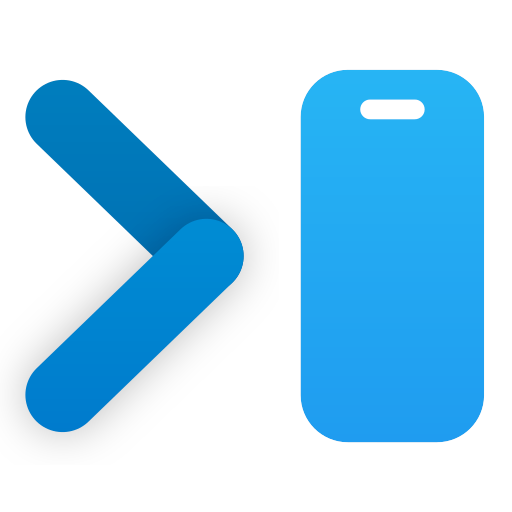

# OffSite

Claude Code, Codex and OpenCode in your browser. It uses the same sessions as their CLIs, so you can start in one and resume in the other.

## Usage

```sh
npx offsite
```

## Separate instances

Give each instance its own port and `--dir`.

```sh
npx offsite --dir ~/.offsite-work
```

## Images, videos and audio

OffSite shows images, videos and audio inline when a reply links to a file with Markdown image syntax, like `` or ``. Relative paths start at the project folder.

The `show` skill teaches agents this syntax. Add it with:

```sh
npx skills add NazmusSayad/offsite --skill show
```

## Huge Thanks

- [T3 Code](https://github.com/pingdotgg/t3code)
- [Ghostty](https://github.com/ghostty-org/ghostty)
- [xterm.js](https://github.com/xtermjs/xterm.js)
- [VS Code](https://github.com/microsoft/vscode)
- [Monaco Editor](https://github.com/microsoft/monaco-editor)
